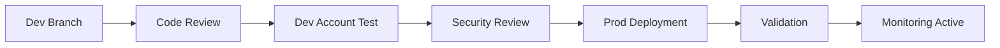
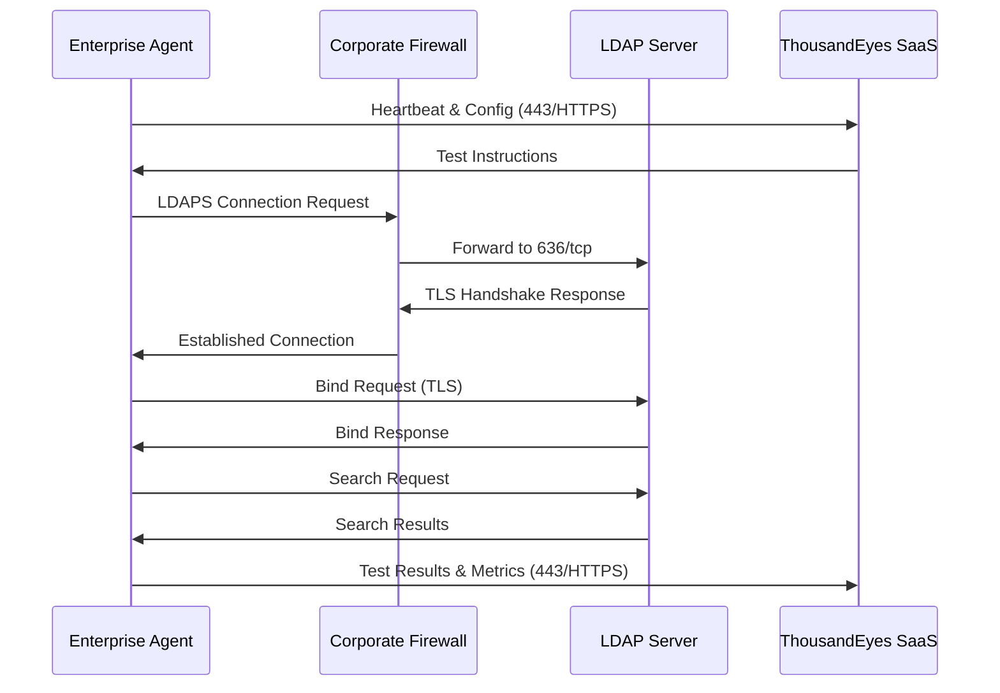

# ThousandEyes LDAP Monitoring Design Document

## Executive Summary

This document outlines the implementation of enterprise-grade LDAP monitoring using ThousandEyes' synthetic monitoring platform. The solution leverages our existing `ldap-monitor.js` script within Web Transaction tests to provide comprehensive LDAP/LDAPS connectivity and performance monitoring across multiple geographic regions.

## 1. Logical Architecture

### 1.1 System Components

- **ThousandEyes SaaS Control Plane**: Centralized orchestration and data collection
- **Enterprise Agents**: Distributed synthetic monitoring agents in each region
- **LDAP Servers**: Target authentication servers (LDAPS, port 636 by default; the test URL may name another port)
- **Firewall Infrastructure**: Network security boundaries requiring rule updates

### 1.2 Architecture Principles

- **Regional Isolation**: Agents monitor only LDAP servers within their region
- **Secure by Design**: All communications use TLS encryption (443 for control, 636 for LDAP). The script refuses a bind over plain LDAP unless the `ldapAllowCleartext` credential is set
- **Least Privilege**: Minimal credential scope with dedicated monitoring accounts
- **High Availability**: Agent clusters provide redundancy and failover

## 2. Connectivity & Firewall Requirements

### 2.1 Required Egress Rules

The following stateful firewall rules must be implemented:

```
# ThousandEyes Control Plane Communication
Source: Enterprise_Agent_Subnets
Destination: *.thousandeyes.com
Port: 443/tcp
Protocol: HTTPS
Purpose: Agent-to-SaaS communication

# LDAP Server Health Checks  
Source: Enterprise_Agent_Subnets
Destination: LDAP_Server_IPs
Port: 636/tcp
Protocol: LDAPS
Purpose: Synthetic monitoring probes
```

### 2.2 Security Considerations

- **Stateful Connections**: All rules are outbound-only with established return traffic
- **Regional Segmentation**: Agents access only same-region LDAP servers
- **TLS Enforcement**: TLS 1.2 minimum (1.3 when the server supports it) for all connections

## 3. Agent-to-Server Mapping

### 3.1 Regional Distribution

| Region | Agent IDs | Target LDAP Servers |
|--------|-----------|-------------------|
| EMEA | `123456`, `123457` | `ldap-emea-01.example.com`, `ldap-emea-02.example.com` |
| AMER | `234567`, `234568` | `ldap-amer-01.example.com`, `ldap-amer-02.example.com` |
| APAC | `345678`, `345679` | `ldap-apac-01.example.com`, `ldap-apac-02.example.com` |

The Terraform in `terraform/` assigns one list of agents (`agent_ids`) to every test it creates. To keep agents in their region, apply it once per region, each with that region's servers and agents (separate state or workspace). Caveat: every apply also creates the `ThousandEyes Monitoring Config` account group, and the `Monitoring Administrator` role where the configuration creates it, so per-region workspaces create duplicate account groups and roles, or name conflicts. Keep that RBAC in one workspace. The configuration cannot skip it yet; gating it is a follow-up (the role is becoming opt-in, but the account group is still always created).

### 3.2 Isolation Benefits

- **Reduced Latency**: Local region testing minimizes network overhead
- **Fault Isolation**: Regional issues don't affect global monitoring
- **Compliance**: Data residency requirements satisfied

## 4. Monitoring Capabilities & Validation

### 4.1 Comprehensive Service Validation

This monitoring solution provides multi-layered validation across all critical LDAP service dimensions:

#### Network Layer Validation
- **TCP Reachability**: Confirms connectivity to port 636 through corporate firewalls
- **Network Path Integrity**: Validates end-to-end routing across regions
- **Firewall Rule Compliance**: Proves egress rules are properly configured

#### Security Layer Validation  
- **LDAPS Certificate Validation**: Verifies certificate chain, expiration, and CA trust (system CAs, or the `ldapCaBase64` credential for a private CA)
- **Certificate Expiry Warning**: Logs a warning when the certificate expires within `ldapCertWarnDays` (default 30 days); the run still passes
- **TLS Protocol Compliance**: Enforces TLS 1.2+ encryption standards
- **Hostname Verification**: Ensures certificate matches target FQDN

#### Application Layer Validation
- **LDAP Service Functionality**: Confirms authentication service is operational via bind operations
- **Directory Query Capability**: Validates a base-scope search of the Root DSE, or of a base DN given in the test URL
- **Protocol Compliance**: Checks that the Root DSE lists LDAPv3 in `supportedLDAPVersion`
- **Directory Health**: Fails when an Active Directory domain controller reports `isSynchronized: FALSE`, when the server clock (`currentTime`) is more than `ldapMaxClockSkewSeconds` (default 300) from the agent clock, or, when `ldapExpectedNamingContext` is set, when `namingContexts` does not include it
- **Credential Validation**: Proves monitoring service accounts are functional

#### Performance Monitoring
Each step is a ThousandEyes marker. The script does not fail a slow run; alert rules on marker durations (`marker_alert_thresholds_ms` in Terraform) do.
- **Connection Latency**: TCP + TLS handshake timing, marker `ldaps-ssl-handshake` (baseline: <100ms; no alert rule by default)
- **Bind Operation Performance**: Authentication response time, marker `ldap-bind` (alert threshold: 300ms)
- **Search Query Performance**: Directory lookup latency, marker `ldap-search` (alert threshold: 300ms)
- **Total Transaction Time**: End-to-end operation duration for SLA reporting

### 4.2 Business Impact Metrics

| Metric | Target | Business Value |
|--------|--------|---------------|
| Availability SLA | 99.9% | User authentication reliability |
| Response Time | <300ms | Optimal user experience |
| Detection Time | Within 2 test intervals (10 minutes at the 300 s default) | Rapid incident response; a shorter interval detects sooner |
| Regional Coverage | 100% | Global service assurance |

## 5. ThousandEyes Configuration

### 5.1 Web Transaction Test Settings

What Terraform sets on each `thousandeyes_web_transaction` test (`terraform/monitoring.tf`):

| Setting | Value |
|---------|-------|
| Test name | `LDAP Check - <server name>` |
| URL | LDAP URL of the server, e.g. `ldaps://ldap-emea-01.example.com:636/` |
| Transaction script | `ldap-monitor.js` |
| Interval | 300 s (`interval`) |
| Time limit | 30 s (`time_limit`, at most half the interval) |
| Credentials | `credential_ids` |
| Console logs | collected |
| Alert rules | the failure rule, and one latency rule per entry in `marker_alert_thresholds_ms` |

### 5.2 Secure Credentials Setup

Create in the ThousandEyes UI or API (not in Terraform, so the values stay out of state), and attach to the tests:
- **`ldapMonUser`**: `cn=monitor,ou=service,dc=example,dc=com`
- **`ldapMonPass`**: Dedicated monitoring account password
- Optional: `ldapCaBase64` for a private CA, `ldapExpectedNamingContext` for a domain controller, and the others in the [README's credentials table](../README.md#credentials)

Anyone with the **View sensitive data in web transaction scripts** permission can read credential values in the web app and through the API. Enable **Disable global credential retrieval** in the organization's security settings to block that.

### 5.3 Alert Rule Configuration

```
Alert Name: LDAP Transaction Failure
Condition: ((txCompletionHasError == true) || (txCompletionTimedOut == true))
Threshold: 2 failing rounds out of 5
Notification: Email (alert_email_recipients)

Alert Name: LDAP Slow ldap-bind (300 ms), LDAP Slow ldap-search (300 ms)
Condition: ((marker[((markerName == "ldap-bind"))]((markerDuration >= 300 ms))))
Threshold: 2 failing rounds out of 5
Notification: Email (alert_email_recipients)
```

Terraform sets only email notifications and leaves severity at its default. Add PagerDuty in ThousandEyes.

## 6. Terraform Infrastructure as Code

### 6.1 Configuration

`terraform/` is a root configuration, not a module. Run it from that directory once per region, with a variable file and a workspace per region (see the agent note in 3.1), for example `terraform workspace select -or-create emea` and then `terraform apply -var-file=emea.tfvars`. Mind the RBAC caveat in 3.1: each workspace also creates the account group (and role). It needs Terraform 1.7 or later. The full variable list is in [terraform/README.md](../terraform/README.md).

```hcl
# terraform/emea.tfvars
ldap_servers = [
  { name = "EMEA 01", hostname = "ldap-emea-01.example.com" },
  { name = "EMEA 02", hostname = "ldap-emea-02.example.com" },
]

agent_ids              = ["123456", "123457"]
credential_ids         = ["1001", "1002"] # ldapMonUser, ldapMonPass, plus optional credentials
alert_email_recipients = ["sre-team@example.com"]

# marker_alert_thresholds_ms = { "ldap-bind" = 300, "ldap-search" = 300 }
```

The provider block reads the token from `var.te_api_token`.

### 6.2 Environment Variables

```bash
export TF_VAR_te_api_token="your-api-bearer-token"
```

## 7. Deployment Workflow

### 7.1 CI/CD Pipeline Stages

The repository's CI (`.github/workflows/ci.yml`) covers the first checks: lint and unit tests on Node 22 and 24, an integration test against 389 Directory Server, and `terraform fmt`, `validate` and `test`. The later stages are the proposed release process.



### 7.2 Access Control Requirements

- **Organization Admin Token**: The Terraform creates an account group (and a role), and managing account groups and roles requires an Organization Admin's API token
- **API Token Scope**: Limited to specific account groups
- **Approval Gates**: Security team sign-off for firewall changes

### 7.3 Rollback Strategy

- **Terraform State Backup**: Before each deployment; `terraform/` configures no backend, so choose a remote backend with versioning
- **Test Disable**: Immediate via API if issues detected
- **Firewall Rollback**: Coordinated with network team

## 8. Operational Considerations

### 8.1 High Availability Design

> **HA Strategy**: Deploy 2+ agents per region with automatic failover

- **Agent Clustering**: Multiple agents ensure service continuity
- **Health Monitoring**: Agents monitored for availability
- **Automatic Failover**: ThousandEyes handles agent failures transparently

### 8.2 Security Operations

#### Credential Rotation
- **Monthly Rotation**: Automated via secrets management
- **Zero-Downtime**: Staged credential updates
- **Audit Trail**: All changes logged with approval workflow

#### Monitoring & Alerting
- **Real-time Alerts**: PagerDuty integration for critical failures (configured in ThousandEyes; Terraform sets email notifications only)
- **Trend Analysis**: Historical performance data for capacity planning
- **Compliance Reporting**: Automated SLA reporting

### 8.3 Maintenance Windows

- **Planned Maintenance**: Coordinated agent updates during low-traffic periods
- **Emergency Response**: 24/7 on-call escalation procedures
- **Change Management**: All modifications via approved change requests

## 9. Network Flow Diagram



## 10. Success Metrics & KPIs

- **Availability SLA**: 99.9% uptime target
- **Performance Threshold**: <300ms bind/search operations (marker alert thresholds)
- **Alert Response**: Detection within 2 test intervals (10 minutes at the default 300 s interval)
- **Coverage**: 100% of production LDAP servers monitored

## 11. Assumptions & Dependencies

- **Network Connectivity**: Firewall team approval for 636/tcp egress
- **Agent Deployment**: Existing ThousandEyes Enterprise Agents operational
- **Credential Management**: LDAP monitoring accounts provisioned
- **Change Management**: Standard enterprise change approval process

---

**Next Steps**: Pending firewall approval, deployment can commence within 2-3 business days following standard change management procedures. 